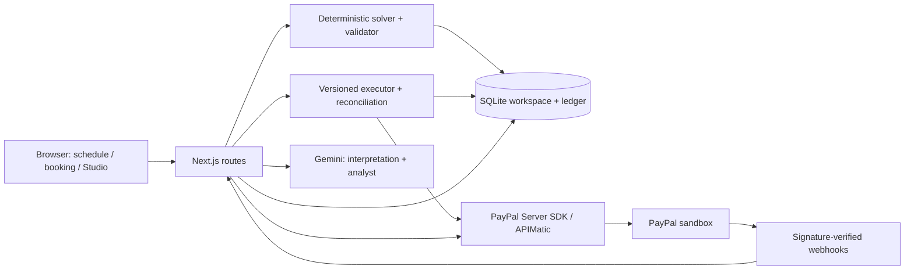

# Rebook

When your schedule breaks, rebook everyone in one click: a recovery desk for class studios, with owner-approved PayPal sandbox refunds.

**[Open the live demo](https://rebook-by9u.onrender.com)** | [How it is built](https://rebook-by9u.onrender.com/built-with) | [Agent-ready flow](https://rebook-by9u.onrender.com/agent-ready)


## Try it in about 60 seconds

The walkthrough takes about 60 seconds once your studio is ready (first load can take up to a minute on free hosting).

1. Click **Open the live demo**. Free hosting may take up to a minute to wake; progress messages explain the wait. Each visitor gets a fictional studio with 42 classes and 120 members.
2. Pick **Maya has the flu and can't teach Monday**, then **Understand disruption > Plan recovery**.
3. Review **9 kept / 16 moved / 6 refunded**, with **$577 kept vs $135 refunded**. Alex covers yoga; dance and barre move to Tuesday. Optionally use **Move** or drag a recovery class; totals update after validation.
4. Click **Approve and refund**. Review the six sandbox refund receipts. If PayPal is slow, **Retry** reconciles existing refunds before another attempt.
5. In **Customer messages and links**, open a card labelled **Private choice link** and choose **Keep** or **Refund**.
6. Open **Dashboard > Ask Recovery analyst** and ask "What did Monday's disruption cost us?" or "Show refunds by reason as a chart".

## What is real

Payments and refunds marked real are actual **PayPal sandbox transactions**; no real money moves. The studio, members and bookings are fictional. The two seeded disruption scenarios use 38 real sandbox captures (31 Monday bookings and seven Wednesday bookings); the rest of the week uses explicitly labelled simulated payments. Customer checkout also creates real sandbox payments. `DEMO_REAL_CAPTURES=0` simulates seeded payments and labels them.

## Built with

[See every integration in the product: /built-with](https://rebook-by9u.onrender.com/built-with)

**PayPal:** Orders v2; JS SDK v6 PayPal buttons and hosted card fields; server-side captures; Payments v2 refunds; Webhooks with signature verification; Transaction Search for uncertain seeded capture reconciliation; the APIMatic-generated PayPal Server SDK for TypeScript. Server credentials stay on the server. A durable ledger and stable `PayPal-Request-Id` protect refund retries.

| Bryntum Scheduler | In Rebook |
| --- | --- |
| EventDrag, date constraints, snapping, async finalization | Adjust proposed classes between instructors/rooms; validate on the server before accepting a drop |
| Tooltips, time ranges and resource time ranges | Explain conflicts; hatch unavailable instructors/rooms and studio closures |
| Event rendering, dependencies, resource columns | Original ghosts, recovery highlights, move arrows and daily utilisation |
| Timezone, day/week views, keyboard selection | Studio-local scheduling, accessible Move dialog and fallback schedule |

[Full Bryntum feature table](docs/bryntum.md#bryntum-features-used)

| AG Studio | In Rebook |
| --- | --- |
| Report, theming, layout and saved state | Week overview, Disruptions and Money pages; Edit report with Rebook's design |
| Custom widgets and forms | Recovery impact, Refund receipts, Week heatmap and Recovery metric |
| Relational data, queries and cross-filtering | Eight related tables; instructor AND day heatmap filters |
| Built-in grids/charts, CSV and chart PNG | Inspect and export revenue, booking actions and the payment ledger |
| Studio Agent Framework and delegation | Custom Recovery analyst delegates to built-in Data, Page, Planning and Widget agents |
| Custom tools, tool cards and provider adapter | Grounded disruption/receipt lookups; Gemini with live tool schemas |
| WebMCP bridge | Read-only schema, report, widget and query tools for a compatible browser assistant |

[Full AG Studio feature table](docs/studio-insights.md#ag-studio-features-used)

**AI:** Gemini interprets text with model fallback and a local rules parser when unavailable. A deterministic solver selects cover/moves and calculates amounts; validation and owner approval control execution. Money never depends on model output. The analyst uses recorded data and displays a friendly outage message while reports keep working.

**WebMCP:** schedule inspection, recovery previews, booking selection and read-only Studio queries. Tools follow page state; approval and payment confirmation remain human actions. [Setup and tool reference](https://rebook-by9u.onrender.com/agent-ready).

## Architecture



## Run locally

Requires Node.js 24+ and a PayPal sandbox REST app. Gemini is optional: without its key, interpretation uses rules and the analyst explains its unavailability.

```sh
npm install
cp .env.example .env.local
# Set PAYPAL_CLIENT_ID, PAYPAL_CLIENT_SECRET, PAYPAL_ENV=sandbox; optionally GEMINI_API_KEY.
npm run build
npm start
# http://localhost:3000
```

See `.env.example` for capture simulation, model fallback, hosting limits, storage and optional trial licences.

## Tests

```sh
# Run a single test file at a time on memory-constrained machines.
npx vitest run test/judge-proofing.test.tsx --pool=threads --maxWorkers=1
npx tsc --noEmit
npm run lint
```

Vitest unit/integration suites mock PayPal and Gemini; they cover solver constraints, owner adjustments, version checks, payment idempotency/reconciliation, webhooks, checkout, customer choices, Studio and WebMCP. Live sandbox, browser geometry and trial behaviour need manual verification.

## Honest limits

- Free Render hosting sleeps and can restart. Workspaces then expire; start a new demo. PayPal retains sandbox transactions. The keep-alive workflow is manual-only; its commented schedule says to enable on Nov 16.
- Recovery stays within one studio week. Moves respect qualifications, availability, clashes and capacity; customers who cannot move need refunds.
- Transaction Search can lag; uncertain seeded captures fall back to visibly labelled simulations. Refund retries reconcile through Payments; a timeout is never reported as a completed refund.
- Bryntum and AG Studio use commercial trial licences; trial notices or watermarks may appear. Gemini free-tier quotas can pause chat; the rules parser and deterministic recovery still work.
- SQLite, rate limits and workspace execution are designed for this single-instance demo. Report layouts persist in browser storage; analyst chat does not.

## Licence

MIT for this repository's code. Bryntum Scheduler and AG Studio have their own commercial licences.
