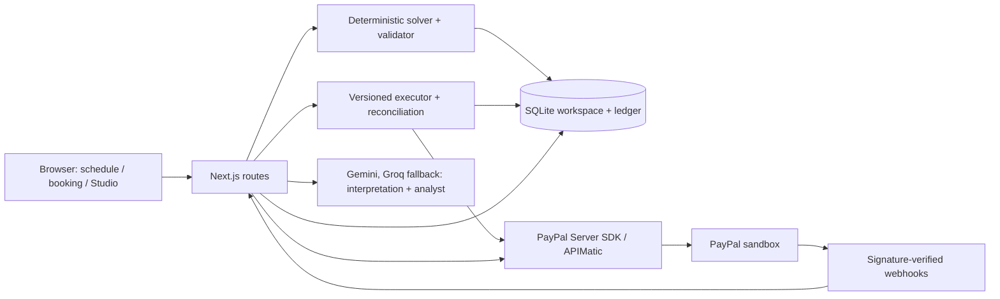

# Rebook

When your schedule breaks, rebook everyone in one approval: a recovery desk for class studios, with owner-approved PayPal sandbox refunds.

**[Open the live demo](https://rebook-by9u.onrender.com)** | [How it is built](https://rebook-by9u.onrender.com/built-with) | [Agent-ready flow](https://rebook-by9u.onrender.com/agent-ready)


## Try it in about 60 seconds

The walkthrough takes about 60 seconds once your studio is ready (first load can take up to a minute on free hosting).

1. Click **Open the live demo**. Free hosting may take up to a minute to wake; progress messages explain the wait. Each visitor gets a fictional studio with 42 classes and 120 members.
2. Pick **Maya has the flu and can't teach Monday**, then **Understand disruption > Plan recovery**.
3. Review **9 kept / 16 moved / 6 refunded**, with **$577 kept vs $135 refunded**. Alex covers yoga; dance and barre move to Tuesday. Optionally use **Move** or drag a recovery class; totals update after validation.
4. Click **Approve and refund**. Review the six sandbox refund receipts. If PayPal is slow, **Retry** reconciles existing refunds before another attempt.
5. In **Customer messages and links**, open a card labelled **Private choice link**. Tell the assistant what works ("anything after 6 this week, otherwise refund me") or choose **Keep**, **Pick another class** or **Refund**.
6. Under **Cover instructors**, open Alex's cover link and accept, then press **Pay Alex $35 with PayPal**: a sandbox PayPal payout.
7. Open **Dashboard > Ask Recovery analyst** and ask "What did Monday's disruption cost us?", "Which class type earns the most revenue?" or "Add a bar chart of revenue by class type".

**Try it on your own week:** [/import](https://rebook-by9u.onrender.com/import) reads one week of a booking-system export (one row per booking), shows every column and class type it understood for you to correct, and builds a private copy of that week to rehearse a recovery on. **Use a sample week** loads a Mindbody-style export if you don't have one to hand. If a substitute says no, the console offers the next qualified instructor who is free and suits everyone booked, in one click.

## What is real

Payments and refunds marked real are actual **PayPal sandbox transactions**; no real money moves. The studio, members and bookings are fictional. By default, the two disruption scenarios prepare 38 sandbox captures (31 Monday bookings and seven Wednesday bookings); the rest of the week is simulated and labelled. Inconclusive prior capture outcomes stay labelled as simulated fallbacks. Customer checkout also creates sandbox payments. `DEMO_REAL_CAPTURES=0` simulates seeded payments and labels them. The server accepts only `PAYPAL_ENV=sandbox` (or unset); every other value is rejected.

## Built with

[See every integration in the product: /built-with](https://rebook-by9u.onrender.com/built-with). PayPal handles sandbox checkout and refunds; Bryntum Scheduler presents the recovery for review; AG Studio reports on workspace records. The APIMatic-generated PayPal Server SDK handles server payment calls. Gemini interprets disruptions and powers the Recovery analyst; Rebook's deterministic solver calculates the plan and amounts. WebMCP exposes page-scoped tools; owner approval and payment confirmation remain human actions.

## What the AI does

| Try in the live demo | What the AI adds | Guardrail | Code |
| --- | --- | --- | --- |
| Paste a forwarded message: "Fwd from Maya: so sorry, fever since last night, can't teach today" | Reads forwarded texts, Hinglish ("Maya bimaar hai, kal class nahi le paayegi") and shorthand that the rules parser cannot | Negations, maybes, corrections, past events and questions never reach the model; its reading must match the names, days and times you wrote; you confirm "AI read this as…" before anything is planned | [interpret.ts](https://github.com/harsha31bs07-blip/rebook/blob/main/lib/ai/interpret.ts#L249-L294), [live report](docs/interpretation-messy-eval.md) |
| On a customer's private link, type what works | Turns "anything after 6 this week, otherwise refund me" into one concrete class or refund | Proposes only; the class must be one of that customer's real options, every amount and the reply about money come from the server, and the customer confirms | [assistant.ts](https://github.com/harsha31bs07-blip/rebook/blob/main/lib/choices/assistant.ts#L18-L59), [live report](docs/customer-assistant-eval.md) |
| Class packs and memberships | Imported pricing options return a visit or release a membership seat, with no PayPal refund | Balances stay in the booking system | [entitlements.ts](lib/domain/entitlements.ts) |
| [/import](https://rebook-by9u.onrender.com/import) > **Use a sample week** | Matches the export's columns and class names ("Slow Burn" is yoga) that exact-name rules cannot | Only column headers and class names are sent, never customer details; every match is shown with how it was made and the owner can change it; no AI runs when the studio is created | [service.ts](https://github.com/harsha31bs07-blip/rebook/blob/main/lib/import/service.ts) |
| Dashboard > Ask Recovery analyst | Answers cost and refund questions from the workspace ledger and edits the AG Studio report | Tool-backed, timestamped answers | [ai.ts](https://github.com/harsha31bs07-blip/rebook/blob/main/lib/insights/ai.ts#L85-L122) |

Models: Gemini first, Groq as fallback; the deterministic solver, server validation and PayPal decide every booking and amount.

## Sponsor evidence

### PayPal

| Try in the live demo | What you see | Code |
| --- | --- | --- |
| **Verify with PayPal** in refund results or ask the Recovery analyst whether PayPal agrees | PayPal Agent Toolkit: read-only Verify with PayPal. Compare sandbox refunds through the toolkit and cover fees through the Payouts API; verification never changes the ledger | [verify.ts](https://github.com/harsha31bs07-blip/rebook/blob/main/lib/paypal/verify.ts#L19-L30) |
| Open Book a class; pay with a sandbox wallet or hosted card fields | JS SDK v6 checkout creates and captures an Orders v2 order on the server | [booking-page.tsx](https://github.com/harsha31bs07-blip/rebook/blob/main/components/booking/booking-page.tsx#L124-L167), [client.ts](https://github.com/harsha31bs07-blip/rebook/blob/main/lib/paypal/client.ts#L210-L214) |
| Complete checkout; inspect the receipt | Booking is recorded only after matching completed capture, order, booking references, currency and amount; class availability is checked before capture | [service.ts](https://github.com/harsha31bs07-blip/rebook/blob/main/lib/checkout/service.ts#L180-L207), [capture checks](https://github.com/harsha31bs07-blip/rebook/blob/main/lib/checkout/service.ts#L168-L178) |
| Approve the Monday recovery; inspect refund results | Payments v2 refunds against original captures; retries reuse `PayPal-Request-Id` = `planId:bookingId` | [client.ts](https://github.com/harsha31bs07-blip/rebook/blob/main/lib/paypal/client.ts#L257-L263), [executePlan.ts](https://github.com/harsha31bs07-blip/rebook/blob/main/lib/executor/executePlan.ts#L67-L80) |
| Accept a cover on its link, then **Pay Alex $35 with PayPal** | Payouts API pays the substitute's cover fee. The payout is recorded before the call, its request id doubles as `sender_batch_id` so a lost response replays the same batch within PayPal's 30-day duplicate check (an older unconfirmed payout stops for a manual check instead), and status comes from PayPal. Cover pay is kept apart from customer money | [cover-pay.ts](https://github.com/harsha31bs07-blip/rebook/blob/main/lib/recovery/cover-pay.ts#L116-L163), [payouts.ts](https://github.com/harsha31bs07-blip/rebook/blob/main/lib/paypal/payouts.ts#L10-L19) |
| Open a private choice link and choose Refund | Customer refund has its own stable `PayPal-Request-Id` = `choice:<linkId>` | [service.ts](https://github.com/harsha31bs07-blip/rebook/blob/main/lib/choices/service.ts#L137-L187) |
| After a sandbox payment/refund, refresh its receipt or Dashboard | Verified webhook deliveries update the ledger; arrival depends on PayPal delivery and webhook configuration | [signature gate](https://github.com/harsha31bs07-blip/rebook/blob/main/app/api/paypal/webhook/route.ts#L6-L48), [ledger update](https://github.com/harsha31bs07-blip/rebook/blob/main/lib/paypal/webhook.ts#L76-L101) |
| Open a studio and inspect payment preparation | New scenarios use sandbox captures. When a previous attempt is uncertain and its replay window has expired, Transaction Search checks matching references and amounts; inconclusive outcomes stay labelled | [createWorkspace.ts](https://github.com/harsha31bs07-blip/rebook/blob/main/lib/demo/createWorkspace.ts#L66-L106), [lookup and search](https://github.com/harsha31bs07-blip/rebook/blob/main/lib/paypal/client.ts#L229-L255) |
| Use checkout or refund Retry | Server SDK controllers perform payment operations with server-only credentials, bounded retries and mapped errors | [client.ts](https://github.com/harsha31bs07-blip/rebook/blob/main/lib/paypal/client.ts#L27-L68) |

### Bryntum Scheduler

Rebook's solver does the re-planning: a fast first pass, then, only when that pass is not provably best, a bounded search over other instructor, room and time assignments. When the plan reaches a proven lower bound (as every demo scenario does), no valid plan keeps more bookings; when it cannot prove that, the plan says so before you approve. Tests compare it with a brute-force search over every valid plan on random small studios, including several rooms and classes of different lengths ([solver-optimality.test.ts](test/solver-optimality.test.ts)). Bryntum Scheduler is the interactive review surface.

| Try in the live demo | What you see | Code |
| --- | --- | --- |
| Plan Maya's Monday recovery; inspect the timeline | Original ghosts, recovery highlights, move arrows and unavailable time ranges | [scheduler-mapping.ts](https://github.com/harsha31bs07-blip/rebook/blob/main/lib/client/scheduler-mapping.ts#L112-L167) |
| Drag a recovery block or use Move | Proposed placement waits for server validation; booking actions and totals are recomputed | [schedule.tsx](https://github.com/harsha31bs07-blip/rebook/blob/main/components/console/schedule.tsx#L173-L193), [adjust route](https://github.com/harsha31bs07-blip/rebook/blob/main/app/api/workspaces/[id]/plans/[planId]/adjust/route.ts#L15-L50) |
| Try moving onto an unavailable instructor or conflicting class | Invalid drop is rejected with a reason; placement stays at the last valid position | [validator](https://github.com/harsha31bs07-blip/rebook/blob/main/components/console/schedule.tsx#L45-L56), [server rejection](https://github.com/harsha31bs07-blip/rebook/blob/main/app/api/workspaces/[id]/plans/[planId]/adjust/route.ts#L15-L50) |
| Adjust a class, then Undo | Prior placement is restored through the same checks and the plan version advances | [adjust route](https://github.com/harsha31bs07-blip/rebook/blob/main/app/api/workspaces/[id]/plans/[planId]/adjust/route.ts#L15-L50) |
| Focus a recovery card; press Enter/Space or use its Move button | Keyboard Move opens the same dialog for day, time, instructor and room | [schedule.tsx](https://github.com/harsha31bs07-blip/rebook/blob/main/components/console/schedule.tsx#L194-L198) |

[Full Bryntum feature table](docs/bryntum.md#bryntum-features-used)

### AG Studio

| Try in the live demo | What you see | Code |
| --- | --- | --- |
| Dashboard > Edit report > Rebook widgets | Recovery impact, Refund receipts, Week heatmap and Recovery metric, with forms | [widgets.tsx](https://github.com/harsha31bs07-blip/rebook/blob/main/components/insights/widgets.tsx#L166-L203) |
| Inspect the dashboard's cards, grids and charts | Rebook's colours and typography through `studioTheme.withParams` | [theme.ts](https://github.com/harsha31bs07-blip/rebook/blob/main/lib/insights/theme.ts#L3-L19) |
| Change the report layout or page, then reload that workspace | Report state saved under a workspace-specific browser-storage key | [studio-report.tsx](https://github.com/harsha31bs07-blip/rebook/blob/main/components/insights/studio-report.tsx#L39-L54) |
| Click a Week heatmap cell, then Clear selection | Other widgets filter by instructor AND day; the matrix remains available | [widgets.tsx](https://github.com/harsha31bs07-blip/rebook/blob/main/components/insights/widgets.tsx#L50-L77) |
| Ask Recovery analyst: "Which class type earns the most revenue?" or "Add a bar chart of refunds by reason" | Direct, timestamped tools answer common questions in one fast call; preset charts are placed through Studio's state API; custom report edits ("Filter to Maya's classes") delegate to the built-in Page/Widget agents | [ai.ts](https://github.com/harsha31bs07-blip/rebook/blob/main/lib/insights/ai.ts#L124-L138) |
| Ask what Monday cost; expand its lookup cards | Custom disruption/receipt tools return workspace records with readable tool cards | [tools](https://github.com/harsha31bs07-blip/rebook/blob/main/lib/insights/ai.ts#L66-L84), [tool-cards.tsx](https://github.com/harsha31bs07-blip/rebook/blob/main/components/insights/tool-cards.tsx#L27-L39) |
| Use the analyst while Gemini is configured | Provider adapter forwards live schemas, cancellation and Google thought signatures; outages show a recoverable message | [gemini-adapter.ts](https://github.com/harsha31bs07-blip/rebook/blob/main/lib/insights/gemini-adapter.ts#L88-L144) |

[Full AG Studio feature table](docs/studio-insights.md#ag-studio-features-used)

### APIMatic

The PayPal context plugin's TypeScript skills for **client initialization, calling endpoints and error handling** guided the migration to the APIMatic-generated `@paypal/paypal-server-sdk` (installed version 2.5.0).

| Try in the live demo | What you see | Code |
| --- | --- | --- |
| Check out, approve a refund, or inspect preparation | `OrdersController` creates/reads/captures orders; `PaymentsController` refunds/reads captures; `TransactionSearchController` searches uncertain preparation outcomes in `lib/paypal/client.ts` | [Orders](https://github.com/harsha31bs07-blip/rebook/blob/main/lib/paypal/client.ts#L187-L227), [Payments and Search](https://github.com/harsha31bs07-blip/rebook/blob/main/lib/paypal/client.ts#L257-L284) |
| Retry/check an uncertain refund | `PaymentsController` reads captures and refunds in `lib/executor/reconcileRefund.ts`; unknown outcomes keep the reservation. A replay reuses the same `PayPal-Request-Id` only within one hour of the first attempt or when PayPal shows no refund; otherwise the refund is held as **Needs review**. A capped background sweep reconciles open refunds, and the owner sees **Payments needing attention** with **Check with PayPal**, then **Retry refund** once PayPal shows no refund | [reconcileRefund.ts](https://github.com/harsha31bs07-blip/rebook/blob/main/lib/executor/reconcileRefund.ts#L16-L49), [refund-policy.ts](https://github.com/harsha31bs07-blip/rebook/blob/main/lib/executor/refund-policy.ts#L8-L20), [refund-sweep.ts](https://github.com/harsha31bs07-blip/rebook/blob/main/lib/executor/refund-sweep.ts#L12-L54) |
| Inspect receipt updates after a verified webhook | SDK 2.5.0 has no signature-verification endpoint. That endpoint and its OAuth exchange use plain fetch with a separate bounded retry wrapper; SDK payment calls use the SDK retry configuration | [verification](https://github.com/harsha31bs07-blip/rebook/blob/main/lib/paypal/client.ts#L286-L296), [fetch retry](https://github.com/harsha31bs07-blip/rebook/blob/main/lib/paypal/client.ts#L119-L131) |

## Architecture



## Run locally

Requires Node.js 24+ and a PayPal sandbox REST app. AI is optional: without either provider key, interpretation uses rules and the analyst explains its unavailability.

Gemini first; Groq takes small requests when Gemini is busy. Set server-only `GEMINI_API_KEY` and optionally `GROQ_API_KEY`. `AI_MODELS` controls the ordered `provider:model` chain; when it is unset, an existing `GEMINI_MODELS` setting keeps the legacy all-Gemini chain. Groq skips input estimated above `GROQ_MAX_INPUT_TOKENS` (default 7000); large delegated Studio turns stay on Gemini. See [AI configuration](docs/studio-insights.md#ai-proxy-and-configuration).

```sh
npm install
cp .env.example .env.local
# Set PAYPAL_CLIENT_ID, PAYPAL_CLIENT_SECRET, PAYPAL_ENV=sandbox; optionally GEMINI_API_KEY and GROQ_API_KEY.
npm run build
npm start
# http://localhost:3000
```

See `.env.example` for capture simulation, model fallback, hosting limits, storage and optional trial licences.

## Tests

```sh
# Run a single test file at a time on memory-constrained machines.
npx vitest run test/judge-proofing.test.tsx --pool=threads --maxWorkers=1
npx tsc --noEmit
npm run lint
```

Vitest unit/integration suites mock PayPal, Gemini and Groq; they cover solver constraints, owner adjustments, version checks, payment idempotency/reconciliation, webhooks, checkout, customer choices, Studio and WebMCP. Live sandbox, browser geometry and trial behaviour need manual verification.

Interpretation is measured against 177 labelled owner statements, including typos, Indian English, slang, ranges and 94 statements that must trigger a clarifying question. The latest live run with Gemini and Groq scored 174/177 (98.31%) with 0 dangerous false positives; the three misses are typos where Rebook asks "Did you mean Maya Chen?" rather than guessing. See [the live report](docs/interpretation-eval.md).

A second, held-out set of 45 messy messages (forwarded texts, Hinglish, third-person reports and 18 that must trigger a question) measures what the AI adds over the rules: rules alone read 22/45; the live chain on pinned model versions read 43/45 with 0 dangerous results; Gemini timed out on several calls and Groq answered most of them ([report](docs/interpretation-messy-eval.md)). The customer assistant scored 22/24 on held-out requests, including prompt-injection attempts, with 0 unsafe actions ([report](docs/customer-assistant-eval.md)).

The functional judge smoke wakes the host, creates one demo workspace, requires a real completed scenario capture and checks the console, booking and dashboard pages: `node scripts/judge-smoke.mjs [base-url]` (or set `JUDGE_SMOKE_BASE`; defaults to the live demo). It creates sandbox captures during preparation and never approves a plan or issues refunds. Its workflow is manual until the commented daily schedule is enabled on Nov 16.

A browser end-to-end check walks the whole judge path on a deployment (interpret, plan, approve with real sandbox refunds, outbox, a customer refund from a phone, the dashboard and a public card checkout) and audits accessibility on each page: `npx playwright-core install chromium` once, then `node scripts/e2e-judge-path.mjs [base-url]`. Before freezing the code, `node scripts/check-permalinks.mjs` lists every code link in this README and on /built-with.

## Pilot readiness

Rebook is built to sit beside a studio's booking system (Mindbody, Glofox, Momence and similar), not replace it: the booking system stays the record of members and payments, and Rebook handles the bad morning. A first real pilot would need:

- **Data in:** [/import](https://rebook-by9u.onrender.com/import) already reads a week from a CSV export; a pilot would read it through the booking system's API instead and write the approved changes back.
- **Owner sign-in** in place of the workspace link, and durable storage (Postgres) in place of per-visitor demo workspaces.
- **Live PayPal:** the studio connects its own PayPal business account (partner onboarding); refunds and cover payouts then run against live captures with the same idempotency and reconciliation.
- **Reach:** SMS alongside email, sent from the studio's own number.
- **Credits:** pack and membership credits synced with the booking system's own ledger.

The core flow (interpretation, the solver, review and approval, customer links, cover acceptance, payouts, reporting) is the same as in the demo. A pilot would still need what a one-week demo leaves out: per-instructor pay rules, waitlists, and a way to correct a recovery after it is approved.

## Honest limits

- Packs and memberships return visits or release seats without cash refunds; balances stay in the booking system.

- Free Render hosting sleeps and can restart. Workspaces then expire; start a new demo. PayPal retains sandbox transactions. The keep-alive workflow is manual-only; its commented schedule says to enable on Nov 16.
- Real email goes only to customers who booked through checkout with their own address (Brevo free plan, daily caps); demo customers use the share buttons. Cover payouts go to one sandbox payee account.
- The owner workspace URL acts as the owner capability for this demo; a real deployment needs owner sign-in. The separate public booking URL (`/b/<bookingId>`) is read/checkout-only and grants no owner access. Customer choice links use separate per-customer tokens.
- Imported weeks carry no customer availability or PayPal payments: customers are assumed to fit any time (and choose on their own page), and refunds are simulated. Class types are limited to six families (yoga, pilates, spin, dance, HIIT, barre).
- Recovery stays within one studio week. Moves respect qualifications, availability, clashes and capacity; customers who cannot move need refunds.
- Transaction Search can lag; uncertain seeded captures fall back to visibly labelled simulations. Refund retries reconcile through Payments; a timeout is never reported as a completed refund, and a refund whose outcome stays unknown is held for owner review instead of being sent again.
- Bryntum and AG Studio use commercial trial licences; trial notices or watermarks may appear. Gemini free-tier quotas can pause chat; the rules parser and deterministic recovery still work.
- SQLite, rate limits and workspace execution are designed for this single-instance demo. Report layouts persist in browser storage; analyst chat does not.

## Licence

MIT for this repository's code. Bryntum Scheduler and AG Studio have their own commercial licences.
