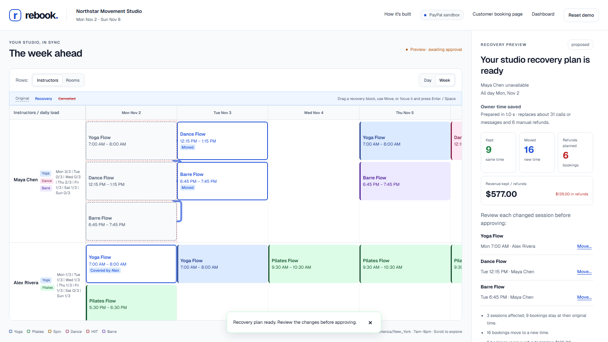
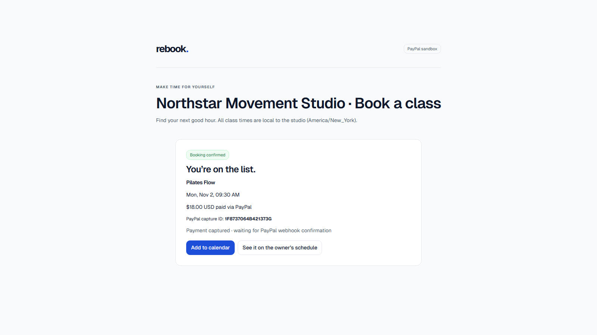
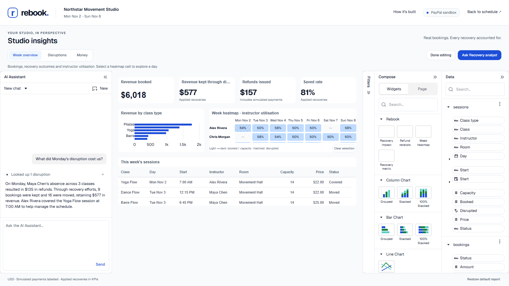
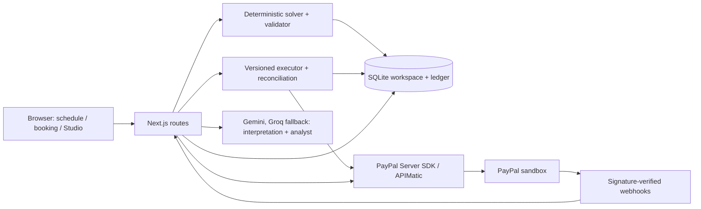

# Rebook

When your schedule breaks, rebook everyone in one click: a recovery desk for class studios, with owner-approved PayPal sandbox refunds.

**[Open the live demo](https://rebook-by9u.onrender.com)** | [How it is built](https://rebook-by9u.onrender.com/built-with) | [Agent-ready flow](https://rebook-by9u.onrender.com/agent-ready)





## Try it in about 60 seconds

The walkthrough takes about 60 seconds once your studio is ready (first load can take up to a minute on free hosting).

1. Click **Open the live demo**. Free hosting may take up to a minute to wake; progress messages explain the wait. Each visitor gets a fictional studio with 42 classes and 120 members.
2. Pick **Maya has the flu and can't teach Monday**, then **Understand disruption > Plan recovery**.
3. Review **9 kept / 16 moved / 6 refunded**, with **$577 kept vs $135 refunded**. Alex covers yoga; dance and barre move to Tuesday. Optionally use **Move** or drag a recovery class; totals update after validation.
4. Click **Approve and refund**. Review the six sandbox refund receipts. If PayPal is slow, **Retry** reconciles existing refunds before another attempt.
5. In **Customer messages and links**, open a card labelled **Private choice link** and choose **Keep** or **Refund**.
6. Open **Dashboard > Ask Recovery analyst** and ask "What did Monday's disruption cost us?", "Which class type earns the most revenue?" or "Add a bar chart of revenue by class type".

## What is real

Payments and refunds marked real are actual **PayPal sandbox transactions**; no real money moves. The studio, members and bookings are fictional. By default, the two disruption scenarios prepare 38 sandbox captures (31 Monday bookings and seven Wednesday bookings); the rest of the week is simulated and labelled. Inconclusive prior capture outcomes stay labelled as simulated fallbacks. Customer checkout also creates sandbox payments. `DEMO_REAL_CAPTURES=0` simulates seeded payments and labels them. The server accepts only `PAYPAL_ENV=sandbox` (or unset); every other value is rejected.

## Built with

[See every integration in the product: /built-with](https://rebook-by9u.onrender.com/built-with). PayPal handles sandbox checkout and refunds; Bryntum Scheduler presents the recovery for review; AG Studio reports on workspace records. The APIMatic-generated PayPal Server SDK handles server payment calls. Gemini interprets disruptions and powers the Recovery analyst; Rebook's deterministic solver calculates the plan and amounts. WebMCP exposes page-scoped tools; owner approval and payment confirmation remain human actions.

## Sponsor evidence

### PayPal

| Try in the live demo | What you see | Code |
| --- | --- | --- |
| Open Book a class; pay with a sandbox wallet or hosted card fields | JS SDK v6 checkout creates and captures an Orders v2 order on the server | [booking-page.tsx](https://github.com/harsha31bs07-blip/rebook/blob/main/components/booking/booking-page.tsx#L74-L168), [client.ts](https://github.com/harsha31bs07-blip/rebook/blob/main/lib/paypal/client.ts#L210-L227) |
| Complete checkout; inspect the receipt | Booking is recorded only after matching completed capture, order, booking references, currency and amount; class availability is checked before capture | [service.ts](https://github.com/harsha31bs07-blip/rebook/blob/main/lib/checkout/service.ts#L84-L118), [capture checks](https://github.com/harsha31bs07-blip/rebook/blob/main/lib/checkout/service.ts#L133-L187) |
| Approve the Monday recovery; inspect refund results | Payments v2 refunds against original captures; retries reuse `PayPal-Request-Id` = `planId:bookingId` | [client.ts](https://github.com/harsha31bs07-blip/rebook/blob/main/lib/paypal/client.ts#L257-L263), [executePlan.ts](https://github.com/harsha31bs07-blip/rebook/blob/main/lib/executor/executePlan.ts#L50-L58) |
| Open a private choice link and choose Refund | Customer refund has its own stable `PayPal-Request-Id` = `choice:<linkId>` | [service.ts](https://github.com/harsha31bs07-blip/rebook/blob/main/lib/choices/service.ts#L118-L155) |
| After a sandbox payment/refund, refresh its receipt or Dashboard | Verified webhook deliveries update the ledger; arrival depends on PayPal delivery and webhook configuration | [signature gate](https://github.com/harsha31bs07-blip/rebook/blob/main/app/api/paypal/webhook/route.ts#L23-L38), [ledger update](https://github.com/harsha31bs07-blip/rebook/blob/main/lib/paypal/webhook.ts#L37-L103) |
| Open a studio and inspect payment preparation | New scenarios use sandbox captures. When a previous attempt is uncertain and its replay window has expired, Transaction Search checks matching references and amounts; inconclusive outcomes stay labelled | [createWorkspace.ts](https://github.com/harsha31bs07-blip/rebook/blob/main/lib/demo/createWorkspace.ts#L76-L107), [lookup and search](https://github.com/harsha31bs07-blip/rebook/blob/main/lib/paypal/client.ts#L230-L254) |
| Use checkout or refund Retry | Server SDK controllers perform payment operations with server-only credentials, bounded retries and mapped errors | [client.ts](https://github.com/harsha31bs07-blip/rebook/blob/main/lib/paypal/client.ts#L27-L69) |

### Bryntum Scheduler

Rebook's solver does the re-planning. Bryntum Scheduler is the interactive review surface.

| Try in the live demo | What you see | Code |
| --- | --- | --- |
| Plan Maya's Monday recovery; inspect the timeline | Original ghosts, recovery highlights, move arrows and unavailable time ranges | [scheduler-mapping.ts](https://github.com/harsha31bs07-blip/rebook/blob/main/lib/client/scheduler-mapping.ts#L118-L165) |
| Drag a recovery block or use Move | Proposed placement waits for server validation; booking actions and totals are recomputed | [schedule.tsx](https://github.com/harsha31bs07-blip/rebook/blob/main/components/console/schedule.tsx#L166-L193), [adjust route](https://github.com/harsha31bs07-blip/rebook/blob/main/app/api/workspaces/[id]/plans/[planId]/adjust/route.ts#L23-L48) |
| Try moving onto an unavailable instructor or conflicting class | Invalid drop is rejected with a reason; placement stays at the last valid position | [validator](https://github.com/harsha31bs07-blip/rebook/blob/main/components/console/schedule.tsx#L44-L57), [server rejection](https://github.com/harsha31bs07-blip/rebook/blob/main/app/api/workspaces/[id]/plans/[planId]/adjust/route.ts#L23-L48) |
| Adjust a class, then Undo | Prior placement is restored through the same checks and the plan version advances | [adjust route](https://github.com/harsha31bs07-blip/rebook/blob/main/app/api/workspaces/[id]/plans/[planId]/adjust/route.ts#L23-L48) |
| Focus a recovery card; press Enter/Space or use its Move button | Keyboard Move opens the same dialog for day, time, instructor and room | [schedule.tsx](https://github.com/harsha31bs07-blip/rebook/blob/main/components/console/schedule.tsx#L152-L162) |

[Full Bryntum feature table](docs/bryntum.md#bryntum-features-used)

### AG Studio

| Try in the live demo | What you see | Code |
| --- | --- | --- |
| Dashboard > Edit report > Rebook widgets | Recovery impact, Refund receipts, Week heatmap and Recovery metric, with forms | [widgets.tsx](https://github.com/harsha31bs07-blip/rebook/blob/main/components/insights/widgets.tsx#L176-L188) |
| Inspect the dashboard's cards, grids and charts | Rebook's colours and typography through `studioTheme.withParams` | [theme.ts](https://github.com/harsha31bs07-blip/rebook/blob/main/lib/insights/theme.ts#L3-L19) |
| Change the report layout or page, then reload that workspace | Report state saved under a workspace-specific browser-storage key | [studio-report.tsx](https://github.com/harsha31bs07-blip/rebook/blob/main/components/insights/studio-report.tsx#L38-L56) |
| Click a Week heatmap cell, then Clear selection | Other widgets filter by instructor AND day; the matrix remains available | [widgets.tsx](https://github.com/harsha31bs07-blip/rebook/blob/main/components/insights/widgets.tsx#L50-L76) |
| Ask Recovery analyst: "Which class type earns the most revenue?" or "Add a bar chart of refunds by reason" | Direct, timestamped tools answer common questions in one fast call; preset charts are placed through Studio's state API; custom report edits ("Filter to Maya's classes") delegate to the built-in Page/Widget agents | [ai.ts](https://github.com/harsha31bs07-blip/rebook/blob/main/lib/insights/ai.ts#L73-L87) |
| Ask what Monday cost; expand its lookup cards | Custom disruption/receipt tools return workspace records with readable tool cards | [tools](https://github.com/harsha31bs07-blip/rebook/blob/main/lib/insights/ai.ts#L54-L72), [tool-cards.tsx](https://github.com/harsha31bs07-blip/rebook/blob/main/components/insights/tool-cards.tsx#L14-L42) |
| Use the analyst while Gemini is configured | Provider adapter forwards live schemas, cancellation and Google thought signatures; outages show a recoverable message | [gemini-adapter.ts](https://github.com/harsha31bs07-blip/rebook/blob/main/lib/insights/gemini-adapter.ts#L11-L101) |

[Full AG Studio feature table](docs/studio-insights.md#ag-studio-features-used)

### APIMatic

The PayPal context plugin's TypeScript skills for **client initialization, calling endpoints and error handling** guided the migration to the APIMatic-generated `@paypal/paypal-server-sdk` (installed version 2.5.0).

| Try in the live demo | What you see | Code |
| --- | --- | --- |
| Check out, approve a refund, or inspect preparation | `OrdersController` creates/reads/captures orders; `PaymentsController` refunds/reads captures; `TransactionSearchController` searches uncertain preparation outcomes in `lib/paypal/client.ts` | [Orders](https://github.com/harsha31bs07-blip/rebook/blob/main/lib/paypal/client.ts#L187-L227), [Payments and Search](https://github.com/harsha31bs07-blip/rebook/blob/main/lib/paypal/client.ts#L257-L284) |
| Retry/check an uncertain refund | `PaymentsController` reads captures and refunds in `lib/executor/reconcileRefund.ts`; unknown outcomes keep the reservation | [reconcileRefund.ts](https://github.com/harsha31bs07-blip/rebook/blob/main/lib/executor/reconcileRefund.ts#L16-L48) |
| Inspect receipt updates after a verified webhook | SDK 2.5.0 has no signature-verification endpoint. That endpoint and its OAuth exchange use plain fetch with a separate bounded retry wrapper; SDK payment calls use the SDK retry configuration | [verification](https://github.com/harsha31bs07-blip/rebook/blob/main/lib/paypal/client.ts#L286-L296), [fetch retry](https://github.com/harsha31bs07-blip/rebook/blob/main/lib/paypal/client.ts#L119-L131) |

## Architecture



## Run locally

Requires Node.js 24+ and a PayPal sandbox REST app. AI is optional: without either provider key, interpretation uses rules and the analyst explains its unavailability.

Gemini first; Groq takes small requests when Gemini is busy. Set server-only `GEMINI_API_KEY` and optionally `GROQ_API_KEY`. `AI_MODELS` controls the ordered `provider:model` chain; when it is unset, an existing `GEMINI_MODELS` setting keeps the legacy all-Gemini chain. Groq skips input estimated above `GROQ_MAX_INPUT_TOKENS` (default 7000); large delegated Studio turns stay on Gemini. See [AI configuration](docs/studio-insights.md#ai-proxy-and-configuration).

```sh
npm install
cp .env.example .env.local
# Set PAYPAL_CLIENT_ID, PAYPAL_CLIENT_SECRET, PAYPAL_ENV=sandbox; optionally GEMINI_API_KEY and GROQ_API_KEY.
npm run build
npm start
# http://localhost:3000
```

See `.env.example` for capture simulation, model fallback, hosting limits, storage and optional trial licences.

## Tests

```sh
# Run a single test file at a time on memory-constrained machines.
npx vitest run test/judge-proofing.test.tsx --pool=threads --maxWorkers=1
npx tsc --noEmit
npm run lint
```

Vitest unit/integration suites mock PayPal, Gemini and Groq; they cover solver constraints, owner adjustments, version checks, payment idempotency/reconciliation, webhooks, checkout, customer choices, Studio and WebMCP. Live sandbox, browser geometry and trial behaviour need manual verification.

The functional judge smoke wakes the host, creates one demo workspace, requires a real completed scenario capture and checks the console, booking and dashboard pages: `node scripts/judge-smoke.mjs [base-url]` (or set `JUDGE_SMOKE_BASE`; defaults to the live demo). It creates sandbox captures during preparation and never approves a plan or issues refunds. Its workflow is manual until the commented daily schedule is enabled on Nov 16.

## Honest limits

- Free Render hosting sleeps and can restart. Workspaces then expire; start a new demo. PayPal retains sandbox transactions. The keep-alive workflow is manual-only; its commented schedule says to enable on Nov 16.
- The owner workspace URL acts as the owner capability for this demo; a real deployment needs owner sign-in. The separate public booking URL (`/b/<bookingId>`) is read/checkout-only and grants no owner access. Customer choice links use separate per-customer tokens.
- Recovery stays within one studio week. Moves respect qualifications, availability, clashes and capacity; customers who cannot move need refunds.
- Transaction Search can lag; uncertain seeded captures fall back to visibly labelled simulations. Refund retries reconcile through Payments; a timeout is never reported as a completed refund.
- Bryntum and AG Studio use commercial trial licences; trial notices or watermarks may appear. Gemini free-tier quotas can pause chat; the rules parser and deterministic recovery still work.
- SQLite, rate limits and workspace execution are designed for this single-instance demo. Report layouts persist in browser storage; analyst chat does not.

## Licence

MIT for this repository's code. Bryntum Scheduler and AG Studio have their own commercial licences.
